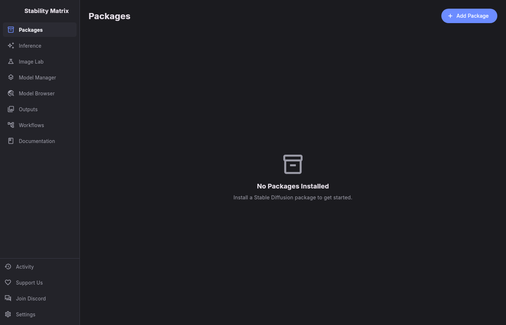
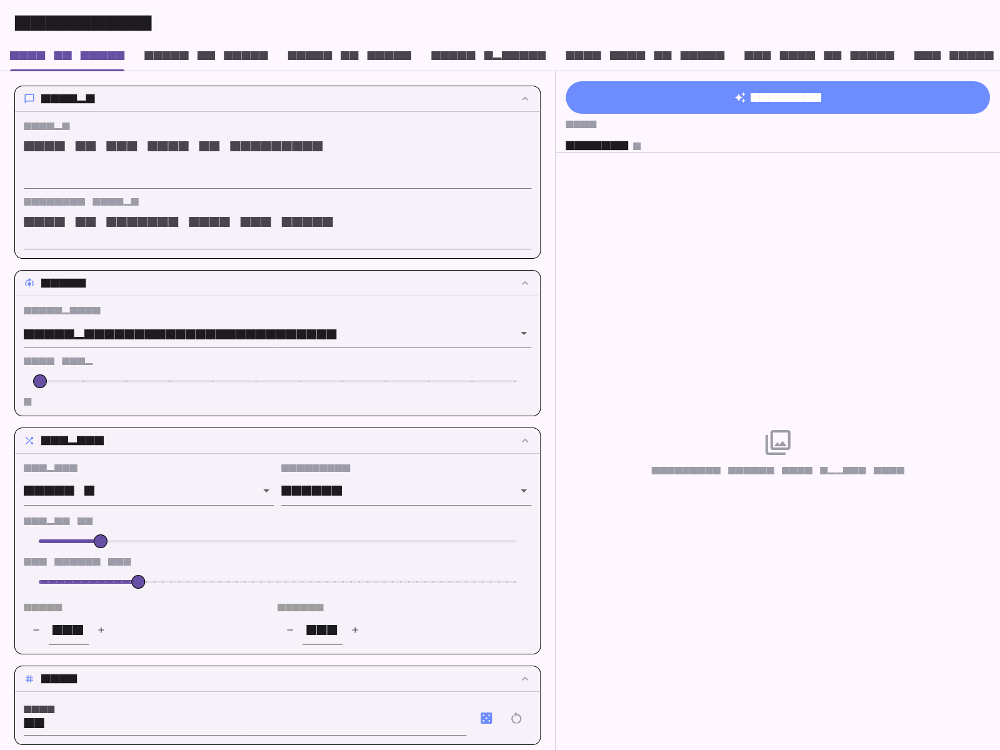
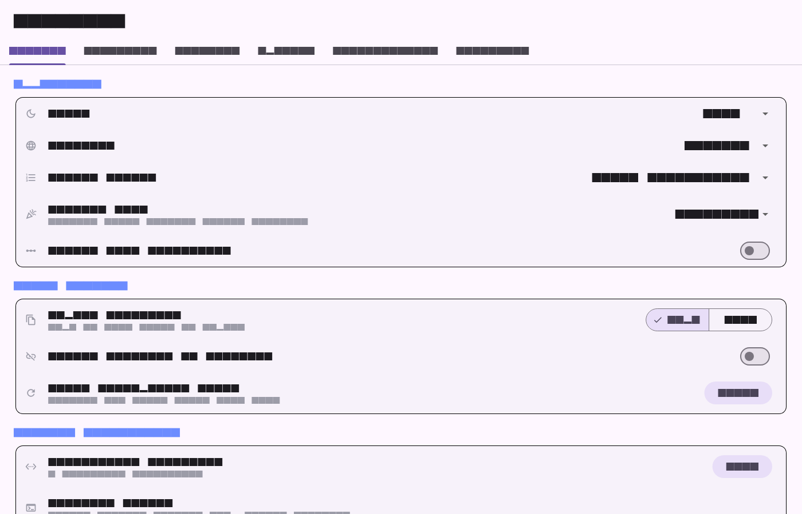

# StableDart

A Flutter desktop port of [StabilityMatrix](https://github.com/LykosAI/StabilityMatrix) — the multi-platform package manager and inference workbench for Stable Diffusion. Install and launch packages like ComfyUI, Stable Diffusion WebUI, Fooocus and 25+ more, keep all your models in one shared library, and generate images from a single app.

[](https://gitlab.com/HttpAnimations/stabledart/-/commits/main)
[](https://gitlab.com/HttpAnimations/stabledart/-/releases)
[](LICENSE)
[](https://httpanimations.gitlab.io/stabledart/)

**Landing page:** https://httpanimations.gitlab.io/stabledart/

## Screenshots

| Main shell | Inference | Settings |
|---|---|---|
|  |  |  |

## Features

- **Package manager** — install, launch and monitor 30+ inference packages (ComfyUI, A1111, Fooocus, InvokeAI, OneTrainer, FluxGym, AI-Toolkit, SwarmUI, Wan2GP and more) with per-package launch options and live consoles.
- **Full inference surface** — 7 generation tabs (txt2img, img2img, img2video, upscale, Flux, WAN t2v/i2v) with all 29 control cards: prompts, models, samplers, seeds, ControlNet, extra networks, FreeU, FaceDetailer, Tiled VAE, regional prompts, upscalers and video output.
- **Shared model library** — one folder of checkpoints, LoRAs, VAEs, ControlNets and upscale models shared across every installed package, with metadata editing and import.
- **Model browser** — CivitAI (types, sorts, periods, NSFW filter, detail pages), Hugging Face repo file browsing with direct downloads, CivArchive search, and OpenModelDB upscaler catalog.
- **Image Lab** — Gemini-powered chat assistant for image workflows with persistent conversations.
- **Outputs & workflows** — generated-image gallery with prompt/seed details and an installed-workflow browser.
- **Activity tracking** — queued, resumable, pausable downloads with speed and progress.
- **Settings** — appearance, import behavior, environment variables, API keys (CivitAI, Hugging Face, Gemini), update checks, notifications and download tuning.

## Platforms

| Platform | Artifacts |
|---|---|
| Linux | `.zip`, `.deb`, `.rpm` |
| Windows | `.zip` |
| macOS | `.dmg`, `.zip` |

There are no Android, iOS or web builds — the app is desktop-only, like the
original. The [landing page](https://httpanimations.gitlab.io/stabledart/) is
hosted on GitLab Pages.

## Download

Grab the latest builds from the [releases page](https://gitlab.com/HttpAnimations/stabledart/-/releases). The app checks GitLab releases for updates automatically.

## Mirrors

- GitLab (primary): https://gitlab.com/HttpAnimations/stabledart
- GitHub (mirror): https://github.com/justacalico/stabledart

## Development

```bash
flutter pub get
flutter analyze
flutter test --coverage          # full suite, 100% line coverage
flutter test --update-goldens    # regenerate golden screenshots
flutter run -d linux             # or windows / macos
```

Commits use [Conventional Commits](https://www.conventionalcommits.org/)
(enforced by `cog check`); install the hook with
`git config core.hooksPath .githooks`. Releases are cut automatically by
cocogitto from `v*` tags — see `cog.toml`.

## License

[AGPL-3.0](LICENSE), matching the licensing of the original StabilityMatrix
project.
